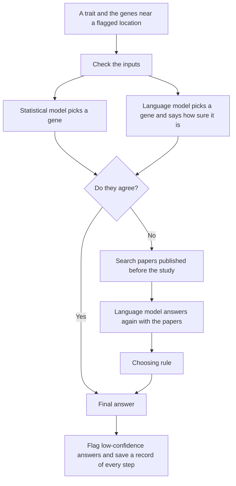

# Which gene is responsible? Testing an AI system on a question genetics studies leave open

Large genetic studies are good at finding *regions* of DNA linked to a disease. They are much worse at saying which gene inside that region is actually responsible. This project builds a system that makes that call using an AI language model, a published statistical model, and a search of the scientific literature, and then measures, as strictly as I could manage, how often it is right.

The measuring turned out to be the larger part of the work. On older, public studies the system beats each of its parts and the published design it extends. On brand-new studies that the AI model could not have seen during its training, the language model's overall lead over the simplest baseline is too small to distinguish from chance. A closer look at those new questions shows why: the model stays well ahead on diseases and general traits and falls well behind on one kind of question, blood protein levels. This README explains what was built, how it was tested, and what the results do and do not show.

## The problem

A genome-wide association study compares the DNA of many thousands of people and flags places where a particular DNA difference is more common in people with a disease or trait. The flag marks a location, not a cause. Stretches of DNA that sit close together are inherited together, so a single flag usually has several genes nearby that all look equally implicated. Working out which one matters is slow, expert work, and it is the step that turns a statistical finding into something a drug developer can act on.

Each question in this project has the same shape:

> Here is a disease or trait, and here is the list of genes near a flagged location. Which one gene is the cause?

The system gives one answer per question, and the answer is either right or wrong.

## The short version

- **On older studies, the full system beat each of its parts.** The full system uses a language model and a statistical model, searches the literature when the two disagree, and then applies a rule to choose between them. On 1,153 questions held out from tuning, it was right on 65.7%. Most of that comes from combining the two models: on all 1,348 older questions, the combination without papers was right on 64.5%, against 59.2% for the language model alone, 56.2% for the statistical model alone, and 47.2% for the simplest baseline (pick the closest gene). The papers added a further 1.7 points on the held-out questions, which is not statistically significant.
- **On new studies, the language model's overall lead was not statistically significant.** On 429 questions from studies published after the model's training ended, it was right on 46.6%, against 43.4% for the closest-gene baseline.
- **Giving the model papers to read made no significant difference on new studies.** It was right on 203 questions with papers and 200 without, at about thirteen times the cost per question.
- **The model has a clear strength and a clear weakness.** On new questions about diseases and general traits, it beat the baseline comfortably. On questions about the level of a specific protein in the blood, it lost to the baseline, and the saved answers show a specific pattern in its mistakes. This split was made after seeing the results.
- **The combined system could barely be tested on new studies.** The statistical model needs data that only 38 of the 429 new questions had.

## Building the test set

An AI language model learns from an enormous amount of text, including scientific papers. If you test it on a study that was published before its training ended, a correct answer may only mean it has read the paper. So the test set had to come from studies the model could not have read, with answers nobody had to pick by hand.

**Checking for memorisation.** Early on I tested whether the model had memorised the most widely used public answer key for this task, a spreadsheet of known gene-disease links from Open Targets. The test asks the model to fill in exact rows of the file, following the approach in Bordt et al., *Elephants Never Forget* (2024). It could not reproduce a single one of 25 rows, while it did reproduce some rows of a famous textbook dataset given the same request, which shows the test can detect memorisation when it is there. That rules out the crudest problem, a model reciting the answer file. It does not rule out the subtler one: a model that has read the papers behind those answers can still name the right gene without having memorised any file. So that answer key was not used for any score reported here.

**Studies the model could not have read.** The language model used here (OpenAI's GPT-5.4) has a documented training cutoff of 31 August 2025. I built a new set of questions only from studies first published after that date, drawn from the public GWAS Catalog.

**How the correct answers were determined.** The method follows an earlier published study (Shringarpure et al.). Sometimes one study finds two signals close together: one whose effect is unclear, and one that directly alters the protein a specific gene makes, which points firmly at that gene. That gene is treated as the correct answer for the unclear signal next to it. The model is asked only about the unclear signal and is never shown the other one. Because the answers come from the genetic data, they do not depend on a list of genes that experts chose by hand.

**Removing questions that distort the score.** Two kinds of question were taken out of the main score:

- *Questions that give away the answer.* In 246 questions the trait's name contains the answer (for example, a trait named after the protein a gene makes). The model got 228 of those right. They are reported separately.
- *The same fact counted many times.* A few genes influence dozens of different blood measurements, so the raw list repeated them dozens of times. Before those repeats were collapsed, adding papers appeared to *hurt* the model noticeably, and about half of that apparent harm traced back to a single gene. After counting each gene once per kind of trait, the effect of papers was close to zero.

That left 429 questions. The statistical model needs extra data from each study (the full results for every DNA variant, and a statistical estimate of which variants matter), and only 38 of the 429 had it.

## What was built

The system is a short sequence of steps, arranged as a flowchart in which later steps depend on what earlier ones found (built with LangGraph, a library for this kind of branching workflow).



In words:

1. Check that the inputs are complete and contain nothing that gives the answer away.
2. The statistical model and the language model each pick a gene. The language model also says how sure it is.
3. If they agree, that gene is the answer.
4. If they disagree, search for relevant papers published before the study, and ask the language model again with those papers in front of it. The choosing rule then picks between the language model's new answer and the statistical model's answer.
5. Flag low-confidence answers for a person to look at, and save a record of every step.

The system can also run with the language model alone, with or without papers. That is how the main new-study test was run.

**The language model** is given only the trait and an alphabetical list of nearby genes, using the exact wording from Shringarpure et al. so results are comparable. It returns one gene, a confidence between 0 and 1, and a short reason.

**The statistical model** is CALDERA, published by other researchers in 2026. It scores each nearby gene from a handful of measurable facts, such as how close the gene is to the flagged location and how well the gene's known biology fits the trait. I ran it as published and did not retrain it.

**The paper search** uses a vector database (LanceDB) holding about 816,000 research summaries. For each question it first narrows to papers about the listed genes that were published before the study being asked about, then returns the 25 closest in meaning to the trait, in roughly a fifth of a second. It also drops any paper that mentions the exact DNA location in the question, so the model cannot be handed the answer.

**The choosing rule** applies only when the two models disagree. It uses the language model's answer (given after reading the papers) when the model reports a confidence of at least 0.85, and the statistical model's answer otherwise. I tried several more elaborate ways of choosing, including ones that used more information from the statistical model. None did better, so the simple rule stayed.

**Safeguards.**

- An answer naming a gene that was not on the list is discarded and counted as wrong.
- Inputs that could leak the answer to the statistical model are refused before anything runs.
- Low-confidence answers are flagged for a person to review. The flag never changes the answer.
- A spending cap stops the run before it exceeds a set budget.
- Every answer is saved, and a replay script re-derives every published score from the saved answers without calling the AI model again.

## How the test was run

**Rules written down before the results were seen.** Which questions count, which comparison is the main one, how uncertainty is reported, and the spending limit were all fixed in writing before the new-study test was run. It was then run once. Anything I looked at afterwards is labelled as such below.

**Uncertainty reported with every number.** Each score comes with a range showing how much it could move if a different set of questions had been drawn. Each comparison is made question by question, counting how many answers a change fixed and how many it broke, with a test of whether that difference could be chance.

## Results

Full tables, with ranges, are in [results_table.md](results_table.md).

### Older studies (used to build and tune the system)

These 1,348 questions come from UK Biobank studies that were public before the language model's training ended, so the model may have had some exposure to them. The statistical model was trained on these same studies. They are a place to develop the method, not proof that it works.

| Method | Correct, of 1,348 | |
| --- | --- | --- |
| Pick the closest gene | 636 | 47.2% |
| Statistical model (CALDERA) alone | 757 | 56.2% |
| Language model alone | 798 | 59.2% |
| Published design: language model combined with the closest gene | 838 | 62.2% |
| This system without papers: language model combined with CALDERA | 869 | 64.5% |

The published design is the one in Shringarpure et al., rebuilt here with the newer language model. Replacing the closest gene with CALDERA as the second opinion added 31 correct answers.

The confidence cut-off in the choosing rule was always set using other chromosomes than the one being scored, so it was never tuned on the questions it was graded on.

**Adding papers.** The way papers are searched and presented was developed on four chromosomes, then run once on the other eighteen:

| Method | Correct, of 1,153 | |
| --- | --- | --- |
| Combined system without papers | 738 | 64.0% |
| Full system, with papers on disagreements | 758 | 65.7% |

Papers fixed 62 answers and broke 42. That gain is not statistically significant (p = 0.06), and more than half of it came from one chromosome.

### New studies (the fair test)

The statistical model could only run on 38 of the 429 new questions, so the main test here is the language model alone, with and without papers, against the closest-gene baseline. The combined system was spot-checked on the 38.

| Method | Correct, of 429 | |
| --- | --- | --- |
| Pick the closest gene | 186 | 43.4% |
| Language model, no papers | 200 | 46.6% |
| Language model, with papers | 203 | 47.3% |

- **Language model against the baseline:** not statistically significant (p = 0.33).
- **Papers against no papers:** not statistically significant (p = 0.79). Papers fixed 31 answers and broke 28. The plausible range for the true effect runs from 11 fewer correct answers to 18 more.

**The 38 questions with both models.** The combined system was right on 24 of 38, with or without papers. That shows the system runs end to end on new studies. It is far too few questions to say more.

### The overall number hides two opposite results

After the run, I split the new questions by type. These splits were not planned in advance, so they are leads to follow up, not conclusions.

| Type of question | Questions | Language model right | Closest gene right | |
| --- | --- | --- | --- | --- |
| Diseases and general traits | 221 | 110 (49.8%) | 78 (35.3%) | Language model better (p = 0.0005) |
| Blood protein levels | 179 | 73 (40.8%) | 97 (54.2%) | Closest gene better (p = 0.01) |

On diseases and general traits, the model's lead over the baseline on new studies (14.5 points) is about the same as on the older studies (12 points). On blood protein levels, the model was clearly worse. The two roughly cancel in the overall score.

**What goes wrong on protein questions.** Each question gives the model a list of genes to choose from. On 23 of the 179 protein questions, the model named a gene that was not on that list, and every time it was the gene that makes the protein in the trait's name. Asked about "circulating CRTAM levels", it answers CRTAM, even though CRTAM is not one of the choices. In these questions the right answer is usually a different gene, one that affects the levels of many proteins from elsewhere in the genome.

**The wording of the question is a likely cause, but probably not the only one.** The wording was taken unchanged from Shringarpure et al. and was not written with protein-level traits in mind. It asks for "the causal gene" for a trait, and for a trait named after a protein, the gene that makes that protein is the natural reading. But there is evidence that wording is not the whole story. When the model was given papers, it almost stopped naming genes that were not on the list (2 times, down from 23), yet it was right on exactly the same number of protein questions (73 of 179). Keeping its answers on the list did not make them correct.

**A follow-up check on the wording.** The test results above were not changed. Separately, to find out how much of the problem was wording, I added one instruction and asked all the new questions again, once, without papers. The instruction says that the trait may be the level of a protein, that the gene making that protein may not be on the list, and that the question is which listed gene changes the trait.

| Type of question | Original wording | With the added instruction | |
| --- | --- | --- | --- |
| Blood protein levels | 73 of 179 | 83 of 179 | 14 fixed, 4 broken (p = 0.03) |
| Diseases and general traits | 110 of 221 | 112 of 221 | No significant change |
| Questions that give away the answer | 228 of 246 | 228 of 246 | No change |

The instruction helped on protein questions and did no harm elsewhere. Answers naming a gene not on the list fell from 23 to 12. It did not close the gap: the closest-gene baseline was still right on 97 of the 179 protein questions against the model's 83, though that difference is no longer statistically significant (p = 0.18). So wording explains part of the weakness, not all of it.

This check was run on the same questions that revealed the problem, so the gain of 10 is probably optimistic. It is a reason to test the new wording on future studies, not a result in itself. The added instruction also lowered the model's stated confidence (the middle value fell from 0.93 to 0.86), so the 0.85 cut-off in the choosing rule would need to be set again before the new wording is used in the combined system.

**The review flag.** Across the new questions, answers flagged for human review were right 19% of the time, against 57% for the rest. The flag was added after the main runs, so that figure describes what happened and was not a prediction.

## Reading the results

- **Combining the two models worked on the older studies.** The combination beat the language model alone by 71 questions and the published design by 31. Both models have had some exposure to those studies (the statistical model was trained on them), so this is a result about the method on familiar ground.
- **There was not enough new data to confirm it.** Only 38 new questions had what the statistical model needs. That is a limit of what recent studies publish, not something more runs could fix.
- **Adding a literature search did not reliably help.** It gave a small, non-significant gain on older studies and none on new ones, at about thirteen times the cost per question.
- **On new studies, the language model's advantage held for diseases and general traits and reversed for protein levels.** The drop in its overall score from older to new studies is therefore not good evidence that it was reciting the older studies: the baseline that uses no AI dropped too, and the new set contains a kind of question the older set does not.
- **The model's errors are not random.** It has a specific blind spot on protein questions. A follow-up check suggests that clearer wording removes part of it, and its confidence does pick out the answers most likely to be wrong.

Two choices in how the test was built changed the conclusions. Without removing repeated questions, papers would have appeared to hurt the model. Without separating the questions that give away the answer, every method's score would have been inflated.

## Limitations

- The older-study results may be helped by the models' exposure to those studies.
- The main new-study comparisons are not statistically significant. The test was large enough to detect a difference of about 6 points, and not a smaller one.
- The breakdown by question type was done after seeing the results.
- The combined system was checked on only 38 new questions.
- The answers are an inference from the genetics, not a laboratory confirmation. The method can only label regions where a protein-altering signal happens to sit nearby, which may not be typical of all regions.
- Results are for one language model at one point in time.
- The papers searched are summaries (abstracts), not full articles.
- I should have estimated how many new questions would be available before building the paper search. Doing that first would have shown early that the new-study test could only detect large effects.

## What I would do next

- Test the added instruction for protein traits on studies published after this project's test set, so it is not graded on the questions that suggested it. The follow-up check here suggests it helps. Set the choosing rule's confidence cut-off again for the new wording before using it in the combined system.
- Extend the statistical model's inputs to more of the new studies, so the combined system can be tested on hundreds of new questions instead of 38.
- Repeat the new-study test as more studies are published, to narrow the ranges.

## What is in this repository

| Path | Contents |
| --- | --- |
| `pipeline/` | The system itself: the flowchart, the paper search, the safeguards, the choosing rule, and the script that re-derives every score from the saved answers |
| `scripts/` | The steps that produced the results: building the question sets, running the statistical model, scoring, and the follow-up analyses |
| `scripts/trait_scores/` | The scripts that built the trait-match scores. They read `TRAIT_SCORES_DIR` |
| `questions/` | The older question file, the nearest-gene file, and the new-study lists |
| `results/` | Saved answers for every reported run, both statistical-model outputs, and the summaries behind `results_table.md` |
| `older_studies/` | The baseline answers on the 1,348 older questions, and the paper-search answers on the 18 held-out chromosomes |
| `early_checks/` | The memorisation check and the list-order check, each with its script and saved summary |
| `tests/` | Automated checks of the safeguards, the paper filters, and the replay |
| `third_party/caldera_run/` | The statistical model's script, trained model, gene maps, and MIT licence |
| `results_table.md` | Every reported number in one place |
| `test_plan.md` | The rules for the new-study test. The rules were fixed on 9 October 2026, before the test was run |

## How to run it

Python 3.11. The statistical model needs R 4.3.1, and only when it is run live rather than replayed from a saved answer. A live model call needs an OpenAI key in `.env`. Replaying the locked scores does not.

```
python -m pip install -r requirements.txt
python -m pytest tests -q
python -m pytest -m "not needs_db" -q
python -m pipeline.reproduce
python -m pipeline.smoke
```

`pytest` runs every check on this machine, including the paper-database checks. `pytest -m "not needs_db"` skips those. The replay command prints the locked counts and stops if one has moved. The last command is a live check of 20 questions and spends a small amount of money. Do not run it just to confirm the locked scores.

These files are not in the repository because they are large or are someone else's data.

| Missing piece | Why | Rebuild |
| --- | --- | --- |
| Paper database, about 5.8 GB, under `data/ukb/final_exam/paper_vectors` | Stored vectors for 816,009 abstracts | `python -m pipeline.build_db`, after the abstract file and the embedding cache are in place. Set `CAUSAL_VARIANT_DATA` if those files live outside the repo |
| Abstract file, about 1.2 GB, under `data/ukb/pubmed` | PubMed titles and abstracts | `python scripts/download_pubmed_weeks.py` |
| Embedding cache and query vectors | Used to build the paper database and to check that a search returns the saved paper list | Produced while the older paper-search runs were embedded. Not needed to replay the scores |
| UK Biobank summary-statistic archive | Large download used while preparing the older questions. The question file, the nearest-gene file, and the saved answers are already in `questions/`, `results/`, and `older_studies/` | The download scripts in `scripts/` |
| Trait-match score files | Credible-set probabilities and gene-fit scores used while building the new questions | Set `TRAIT_SCORES_DIR`, then `scripts/download_ot_pips.py`, `scripts/build_final_exam_neighborhoods.py`, and `scripts/build_exam_b_caldera_inputs.py`. Not needed to replay the scores |

The tests in `tests/test_retrieve.py` need the paper database. The other tests run from the code alone.

## Sources and credit

- The question wording, the labelling approach, and the older question sets follow Shringarpure et al., *Large language models identify causal genes in complex trait GWAS* (medRxiv).
- The statistical model is CALDERA, from Schipper et al. (PLOS Genetics, 2026), used under its MIT licence. Its gene-fit scores (PoPS) are from Weeks et al.
- The older question file and the nearest-gene file are from Shringarpure's Zenodo archive (doi:10.5281/zenodo.15594712), used under CC-BY-4.0.
- New-study questions are built from the NHGRI-EBI GWAS Catalog. Research summaries are from PubMed.
