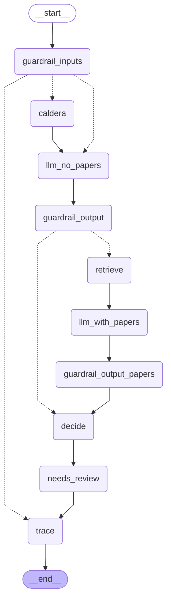

# Method graph

Two modes share this graph. `combined` runs the statistical model and the language model. `llm_only` skips the statistical model. Papers are retrieved only when that mode asks for them, and in the combined mode only when the two methods disagree.

